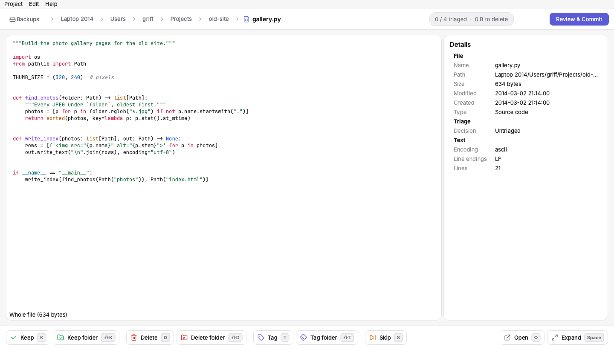

<p align="center">
  
</p>

<h1 align="center">Degreaser</h1>

<p align="center"><b>Clean up a huge pile of old files, one file at a time.</b></p>

<p align="center">
  <a href="https://github.com/griffhurt/degreaser/releases/latest"></a>
  <a href="https://github.com/griffhurt/degreaser/actions/workflows/ci.yml"></a>
  <a href="LICENSE"></a>
</p>

Degreaser is a desktop app for macOS, Windows and Linux for working through large, messy
folders, such as years of old computer backups on a NAS. It shows you each file with a
preview, and you decide with a single key whether to **keep** it, **delete** it, **tag** it
with a category, or **skip** it for later.

**Nothing changes on disk until you say so.** Your decisions are saved as you go. When you're
done, review them and **commit**: deletions go to a recoverable Degreaser trash folder (or are
deleted permanently, if you prefer), and your categories are written to a catalog.

<picture>
  <source media="(prefers-color-scheme: dark)" srcset="docs/assets/screenshot-dark.png">
  
</picture>

## Features

- **Keyboard-first triage.** One key per decision, folder-wide actions (keep, delete or tag a
  whole folder at once), undo that survives restarts, and shortcuts you can remap.
- **Previews for almost everything:** text and code (syntax-highlighted), images (including
  AVIF, and HEIC on macOS), video and audio in old formats like AVI, WMV and MPEG, PDFs, Word,
  Excel, PowerPoint and OpenDocument files, and the contents of zip, 7z, RAR and tar archives.
- **Local folders and SMB shares.** Connect to a NAS directly. Previews read only what they
  need, slow files load in the background while you carry on, and passwords stay in your
  system's password store.
- **Categories** like `Videos › High School › Senior Film Project`, with autocomplete that
  learns from what you've already used.
- **Rules** that handle the obvious junk (system files, caches, build output) and the things
  you always keep, so you never see them.
- **Duplicate detection** that finds byte-identical copies in the background and can delete
  the extra copies once you've kept one.
- **Safe commits.** Every file is re-checked before it's touched, the commit can be paused or
  resumed after a crash, and you get a report of everything it did.
- **Work across computers.** Sync your progress through the project folder and pick up on
  another machine. One computer decides at a time; the others can look read-only.

## Download

Get the latest version from the [releases page](https://github.com/griffhurt/degreaser/releases/latest).

| Platform | Download | Notes |
|---|---|---|
| macOS 14+ (Apple silicon) | `Degreaser-…-macOS.dmg` | Signed and notarised. |
| Windows 10/11 (64-bit) | `Degreaser-…-Windows-Setup.exe` | Installs for your user account. Not yet code-signed, so Windows may ask you to confirm (**More info → Run anyway**). |
| Linux (64-bit) | `Degreaser-…-x86_64.AppImage` | Make it executable and run it. |

Degreaser keeps itself up to date: it checks for new versions daily (you can turn this off in
Preferences).

**New to Degreaser?** The [user guide](docs/user-guide.md) walks through your first project,
triage, categories, duplicates, committing, and using more than one computer.

## Building from source

You need [uv](https://docs.astral.sh/uv/). It installs the right Python (3.14) for you.

```sh
git clone https://github.com/griffhurt/degreaser.git
cd degreaser
uv sync --all-groups
uv run degreaser
```

Run the checks with:

```sh
uv run pytest
uv run ruff check . && uv run ruff format --check . && uv run pyright
```

The SMB tests need a local Samba server, which runs in Docker:

```sh
docker compose -f tests/integration/docker-compose.yml up -d --build --wait
```

To build a standalone app (in `dist/`):

```sh
uv run --group build pyinstaller packaging/degreaser.spec --noconfirm
```

## Feedback

Found a bug or have an idea? Please [open an issue](https://github.com/griffhurt/degreaser/issues).
Bug reports are most useful with your operating system, the Degreaser version (Help →
About Degreaser, or Degreaser → About Degreaser on macOS), and the steps that led to the
problem.

## Licence

Degreaser is released under the [MIT licence](LICENSE).

It's built with [Qt](https://www.qt.io) through [PySide6](https://doc.qt.io/qtforpython-6/)
(LGPL, bundled as separate, replaceable libraries) and uses Qt's FFmpeg backend for audio and
video. Bundled assets and libraries:

- [Inter](https://rsms.me/inter/) and [JetBrains Mono](https://www.jetbrains.com/lp/mono/) fonts, under the SIL Open Font License (`src/degreaser/ui/assets/fonts/`).
- [Lucide](https://lucide.dev) icons, under the ISC licence (`src/degreaser/ui/assets/icons/LICENSE-lucide.txt`).
- Release builds include [Sparkle](https://sparkle-project.org) on macOS and [WinSparkle](https://winsparkle.org) on Windows for updates, both MIT-licensed; their licence texts ship with the app.
